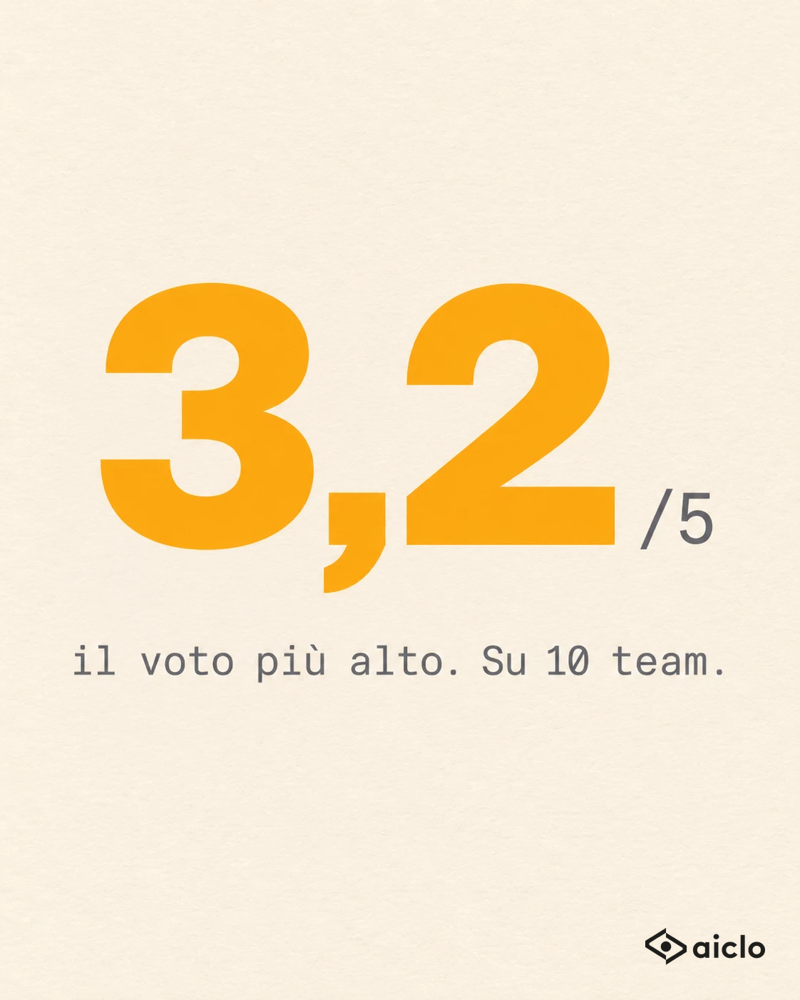

# Il problema è Marco: obiezioni, 10 team su 10 sotto il 3,2

**Autore** — Andrea Aureli · **Brief** — Target: Manager · Leva: "Non sai perché" (il punto cieco del 95%) · Struttura: S1 Ribaltamento · Obiettivo: commenti
**Fonti dati** — `dati/insight-trattative.md` riga 8 (approvata: 10 aziende clienti su 10 fra 2,5 e 3,2 sulla gestione delle obiezioni, media 2,8, circa 17.000 trattative) e riga 1 (claim pubblico: un manager ascolta il 5% delle trattative). Il direttore commerciale, "Marco" e il corso: **storia costruita**. La traduzione in pagella (3,2/5 = 6,4/10; 2,8/5 = 5,6/10) è un calcolo sui dati approvati.

> Scelte di calendario: è il primo post di Andrea, quindi niente da non ripetere. Target Manager perché l'ultimo post uscito (Simone, oggi) era per i venditori. Tema diverso da quello di Simone (implicazioni, righe 3, 4 e 9): qui si usa la riga 8, mai usata.
>
> **Versione 2**, riscritta con `guide/09-stile-copy.md`. La versione 1 (240 parole, con lista e "cosa fare lunedì") è nella cronologia git.

## Hook alternativi
1. **Numero che fa male:** 10 aziende, 10 metodi diversi. Sulle obiezioni nessuna supera il 3,2.
2. **Il caso che smentisce:** «Il problema è Marco. Sulle obiezioni crolla.»
3. **Criterio:** Quando un manager mi chiede un corso sulle obiezioni, faccio una domanda sola.

Scelto il **n. 2**: è una frase che ogni manager ha detto o pensato, quindi ci si riconosce subito.

**Anello aperto:** la domanda è "ma è davvero colpa di Marco?". Si chiude solo nelle ultime due righe: Marco è solo quello che il capo ha sentito, gli altri nessuno li ha sentiti.

## Post
«Il problema è Marco. Sulle obiezioni crolla.»

Un direttore commerciale me l'ha detto così, con la sicurezza di chi ha già deciso. Voleva mandarlo a un corso. Il terzo in due anni.

Gli ho chiesto come andavano gli altri.
«Gli altri se la cavano.»

Qualche settimana dopo abbiamo messo in fila le trattative di 10 aziende che seguiamo: settori diversi, metodi diversi, circa 17.000 trattative registrate. Su ognuna, un voto da 1 a 5 su come il venditore gestisce le obiezioni.

Il migliore dei dieci team prende 3,2. A scuola sarebbe un 6 stiracchiato.
La media è 2,8. Un 5 e mezzo.
Nessun team su dieci la fa bene.

Quindi Marco non è un'eccezione. È la regola.

La differenza è che Marco, quel giorno, il suo capo l'aveva sentito.
Un manager ascolta in media il 5% delle trattative del suo team. Marco era finito nel 5%.

Gli altri non se la cavano.
Nessuno li ha ancora sentiti.

## Visual
Tipo: numero gigante (Template H)

**Immagine scelta, pronta da pubblicare (con il logo):**



- Da pubblicare: `img/2026-11-09-obiezioni-3-2-con-logo.png` (logo nero in basso a destra, 15% della larghezza, margine 48px)
- Originale senza logo: `img/2026-11-09-obiezioni-3-2.webp`
- Anteprima di come appare su LinkedIn (nel feed e dopo "…altro"): `img/2026-11-09-obiezioni-3-2-anteprima.png`
- Controllato: il numero è "3,2" con la virgola, "/5" e la riga "il voto più alto. Su 10 team." sono giusti.

Prompt di riferimento:
```
Poster minimalista, formato verticale 4:5, 1080x1350. Sfondo carta color crema #F5F0E6,
con una grana leggera da carta vera. Un solo numero enorme che occupa il 60% dell'altezza:
"3,2", font Sora extra bold, colore ambra #F9A517, centrato e leggermente spostato verso l'alto.
Accanto al numero, piccolo e in basso a destra della cifra, in IBM Plex Mono grigio #6B7280: "/5".
Sotto il numero, in IBM Plex Mono grigio #6B7280, una sola riga: "il voto più alto. Su 10 team."
Nient'altro: nessuna icona, nessuna cornice, nessuna persona. Molto spazio vuoto.
Lasciare libero l'angolo in basso a destra per il logo (nessun logo generato).
```
Anomalia: il record, il voto del team migliore, è una sufficienza stiracchiata scritta in grande come se fosse un trionfo.

Note per la grafica:
- È tipografica: si fa in 3 minuti in Canva/Figma con i font veri (Sora, IBM Plex Mono), ed è più sicuro che generarla, perché il numero deve essere esattamente "3,2" con la virgola.
- Logo: `brand/logo-nero.png` sovrapposto in basso a destra, circa 15% della larghezza, margine 48px.
- Alternanza: il post di Simone di oggi ha una lavagna fotografata; questa è una card chiara tipografica, quindi niente card scura e nessun tipo ripetuto.

## Primo commento (facoltativo)
Manager: qual è l'obiezione che senti di più nelle trattative del tuo team? Scrivila con le parole esatte del cliente, non con quelle del manuale.

## Checklist
**19/19**
- ✅ Prima riga di 7 parole: una frase vera da manager, che funziona da sola.
- ✅ Anello aperto ("è davvero colpa di Marco?") chiuso solo nelle ultime due righe.
- ✅ Una sola idea: il problema che vedi è quello che senti; il resto è nel punto cieco.
- ✅ Nemico: la credenza "è colpa di quel venditore, mandiamolo a un corso".
- ✅ Numeri reali e approvati (righe 8 e 1), tradotti in pagella. Citati come "aziende che seguiamo", senza nomi né settori.
- ✅ Storia costruita (il direttore, Marco, il corso) anonima, verosimile e segnalata nelle Fonti dati.
- ✅ Target manager chiaro dalla prima riga; leva "Non sai perché".
- ✅ Circa 165 parole, nessuna lista, nessuna morale spiegata, nessun "cosa fare lunedì".
- ✅ Zero emoji, nessuna parola vietata, nessun trattino lungo, nessun link.
- ✅ Chiusura in due righe brevi, citabile, che risponde all'apertura ("gli altri se la cavano").
- ✅ Aiclo non nominato.
- ✅ Punge un'abitudine (dare la colpa a chi si è sentito), non una persona. Due contrapposizioni in tutto.
- ✅ I 4 test del file `09`: nessun paragrafo si può togliere senza perdere un pezzo della storia.
- ✅ Voce di Andrea: da imprenditore che ragiona sui numeri, diretto senza prediche.

Da verificare con Andrea prima di pubblicare:
- La scena del direttore commerciale è costruita: se ne ha una vera simile, meglio la sua.
