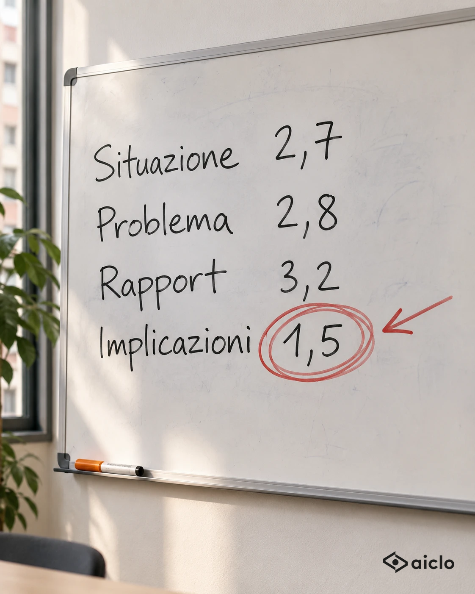

# Bravissimi a farci voler bene: implicazioni 1,5 su 5

**Autore** — Simone Continenza · **Brief** — Target: Venditore · Leva: Le provvigioni lasciate sul tavolo · Struttura: S3 Confessione (dal campo) · Obiettivo: commenti
**Fonti dati** — `dati/insight-trattative.md` righe 3, 4 e 9 (dati reali via MCP). La scena del CRM è una situazione tipo, non un episodio preciso.

## Hook alternativi
1. **Confessione con numero:** Abbiamo dato un voto alle nostre trattative. In una fase prendiamo 1,5 su 5.
2. **Scena:** Il cliente ci racconta il problema. Noi annuiamo. E passiamo subito alla demo.
3. **Ribaltamento:** Il mio team è bravissimo a farsi voler bene. Ed è proprio questo il problema.

Scelto il **n. 3**: è un complimento che diventa un'accusa, e la curiosità ("perché sarebbe un problema?") porta al "…altro". L'accusa è al team di Simone, non a chi legge. Il numero 1,5 arriva subito dopo, come prova.

## Post
Il mio team è bravissimo a farsi voler bene. Ed è proprio questo il problema.

Lo so perché gli abbiamo dato un voto.
Di mestiere vendo un software che analizza le trattative: un giorno l'abbiamo puntato su di noi.

343 trattative, metodo SPIN.
Situazione: 2,7.
Problema: 2,8.
Rapport: 3,2.
Implicazioni: 1,5.

Tradotto: il cliente ci racconta il problema e si trova bene con noi.
Poi, proprio quando dovremmo chiedere «e questo quanto vi costa?», partiamo con la demo.

Il cliente dice: «I miei venditori compilano il CRM la sera, a memoria.»
Noi: «Perfetto, le faccio vedere come funziona.»

Pensavo fosse un difetto nostro.
Poi ho guardato le aziende clienti che seguiamo: in 7 su 10 l'apertura prende almeno un punto in più della parte in cui si scava.

Non è pigrizia. È educazione.
Chiedere le conseguenze sembra mettere il dito nella piaga, e a nessuno piace farlo con uno sconosciuto.

Ma senza quella domanda il cliente un problema ce l'ha.
Un motivo per risolverlo adesso, no.

Da domani nel mio team la domanda è una: «E se non cambia niente, fra sei mesi dove siete?»

Il rapport ti fa entrare. Le implicazioni ti fanno firmare.

## Visual
Tipo: scritto a mano (Template K), generata.

**Immagine scelta, pronta da pubblicare (con il logo):**



- Da pubblicare: `img/2026-11-09-implicazioni-1-5-con-logo.png` (logo nero in basso a destra, 15% della larghezza, margine 48px)
- Originale senza logo: `img/2026-11-09-implicazioni-1-5.webp`
- Anteprima di come esce nel feed: `img/2026-11-09-implicazioni-1-5-anteprima.png`
- Controllato: i quattro numeri e le virgole sono giusti (2,7 · 2,8 · 3,2 · 1,5).

Alternativa ancora più forte, se Simone ha 5 minuti: rifarla con una foto vera alla lavagna, magari con lui di spalle con il pennarello in mano (Template L).

Prompt usato:
```
Fotografia realistica di una lavagna bianca in una piccola sala riunioni di un'azienda italiana,
ripresa di 3/4 con luce naturale da una finestra a sinistra, formato verticale 4:5, 1080x1350.
Scritto a pennarello nero, grafia vera, un po' storta, quattro righe una sotto l'altra:
"Situazione 2,7"
"Problema 2,8"
"Rapport 3,2"
"Implicazioni 1,5"
Il numero "1,5" è cerchiato tre volte con un pennarello rosso, con una freccia che lo indica.
Un pennarello color ambra #F9A517 appoggiato sul bordo della lavagna. Vecchie cancellature appena visibili sullo sfondo.
Nessuna persona, nessun altro testo. Profondità di campo ridotta sul cerchio rosso.
Lasciare libero l'angolo in basso a destra per il logo (nessun logo generato).
```
Anomalia: tre voti "normali" e un 1,5 cerchiato in rosso, come alla lavagna di scuola.

## Primo commento (facoltativo)
Venditori: qual è la domanda che sapete di dover fare in trattativa e che saltate quasi sempre? La mia era quella sulle conseguenze.

## Checklist
**17/17**
- ✅ Prima riga di 15 parole, un'accusa (rivolta al proprio team); funziona da sola.
- ✅ Una sola idea: saltiamo la domanda sulle conseguenze.
- ✅ Nemico: l'abitudine di passare alla demo appena il cliente racconta il problema.
- ✅ Numeri reali e approvati (righe 3, 4 e 9 di `dati/insight-trattative.md`), uno ogni 50-80 parole.
- ✅ Nessuna testimonianza inventata; la battuta sul CRM è una situazione tipo, nessun cliente riconoscibile.
- ✅ Target venditore chiaro dalle prime righe; leva: le provvigioni lasciate sul tavolo.
- ✅ Circa 220 parole, paragrafi brevi, zero emoji, nessuna parola vietata, nessun link.
- ✅ Chiusura in una frase, citabile.
- ✅ Aiclo non nominato (solo "un software che analizza le trattative").
- ✅ L'errore è nostro, non del lettore. Due contrapposizioni in tutto ("Non è pigrizia. È educazione." e la chiusura).
- ✅ Voce di Simone: da campo, da collega, ironia asciutta.

Nota: i numeri delle righe 3-4 sono del team commerciale di Aiclo, quelli della riga 9 delle aziende clienti, e il post li cita così. Il punteggio personale di Simone non è usato: se vuole renderlo ancora più forte, può aggiungere il suo, che però va deciso da lui.

## Cosa è cambiato dalla bozza
Righe del post cambiate fra la prima bozza e la versione approvata (servono per imparare: vedi `guide/09`).

Tolte:
- ~~Abbiamo dato un voto alle nostre trattative. In una fase prendiamo 1,5 su 5.~~
- ~~Contesto: di mestiere vendo un software che analizza le trattative.~~
- ~~Un giorno l'abbiamo puntato su di noi.~~
- ~~343 trattative del nostro team, metodo SPIN.~~
- ~~Tradotto: siamo bravi a farci raccontare il problema. E a farci voler bene.~~

Aggiunte:
- Il mio team è bravissimo a farsi voler bene. Ed è proprio questo il problema.
- Lo so perché gli abbiamo dato un voto.
- Di mestiere vendo un software che analizza le trattative: un giorno l'abbiamo puntato su di noi.
- 343 trattative, metodo SPIN.
- Tradotto: il cliente ci racconta il problema e si trova bene con noi.
